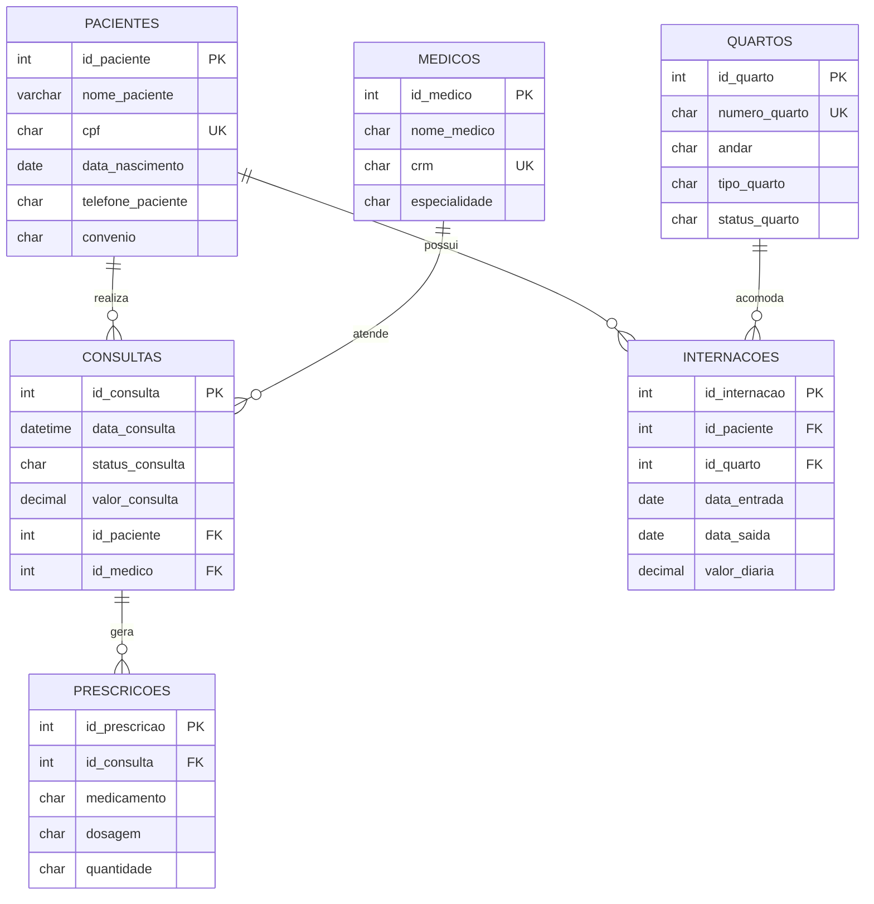

# 🏥 hospital_db — Consultas SQL

Projeto de estudo em **MySQL 8.0** com um banco de dados hospitalar fictício. O repositório reúne 10 consultas SQL que respondem a situações-problema de diferentes setores do hospital (financeiro, clínico, farmácia, auditoria, cobrança etc.), usando `JOIN`, `GROUP BY`, funções de agregação (`SUM`, `AVG`, `COUNT`) e filtros com `LIKE` / `IN`.

---

## 📂 Estrutura do banco

O banco `hospital_db` possui 6 tabelas:

| Tabela        | Descrição                                              | Registros |
|---------------|--------------------------------------------------------|-----------|
| `pacientes`   | Dados cadastrais e convênio de cada paciente           | 10 |
| `medicos`     | Médicos, CRM e especialidade                           | 10 |
| `consultas`   | Consultas realizadas (data, status, valor)             | 10 |
| `quartos`     | Quartos do hospital (andar, tipo e status)             | 10 |
| `internacoes` | Internações de pacientes em quartos (entrada, saída, valor da diária) | 10 |
| `prescricoes` | Medicamentos prescritos em cada consulta               | 10 |

### Diagrama de relacionamentos



---

## ⚙️ Como executar

1. Crie o banco e importe os dumps (a ordem importa por causa das chaves estrangeiras):

```bash
mysql -u root -p -e "CREATE DATABASE hospital_db;"

mysql -u root -p hospital_db < hospital_db_pacientes.sql
mysql -u root -p hospital_db < hospital_db_medicos.sql
mysql -u root -p hospital_db < hospital_db_quartos.sql
mysql -u root -p hospital_db < hospital_db_consultas.sql
mysql -u root -p hospital_db < hospital_db_internacoes.sql
mysql -u root -p hospital_db < hospital_db_prescricoes.sql
```

2. Entre no banco e rode as consultas abaixo:

```sql
USE hospital_db;
```

> **Observação:** o banco usa a collation `utf8mb4_0900_ai_ci` (*accent-insensitive* e *case-insensitive*), então `LIKE '%Saúde%'` também encontraria "Saude" ou "SAÚDE".

---

## 📝 Consultas

### 1. Faturamento total de consultas por convênio

**Problema:** o setor financeiro precisa do valor total arrecadado em consultas para os convênios que possuem "Saúde" no nome.

```sql
SELECT
    p.convenio,
    SUM(c.valor_consulta) AS faturamento_total
FROM consultas c
INNER JOIN pacientes p ON p.id_paciente = c.id_paciente
WHERE p.convenio LIKE '%Saúde%'
GROUP BY p.convenio;
```

**Resultado esperado:**

| convenio       | faturamento_total |
|----------------|-------------------|
| Bradesco Saúde | 400.00 |

---

### 2. Média do valor de consulta por especialidade médica

**Problema:** a coordenação clínica quer a média do valor das consultas realizadas nas especialidades ligadas à Cardiologia.

```sql
SELECT
    m.especialidade,
    AVG(c.valor_consulta) AS media_valor_consulta
FROM consultas c
INNER JOIN medicos m ON m.id_medico = c.id_medico
WHERE m.especialidade LIKE '%Cardiologia%'
  AND c.status_consulta = 'Realizada'
GROUP BY m.especialidade;
```

**Resultado esperado:**

| especialidade          | media_valor_consulta |
|------------------------|----------------------|
| Cardiologia            | 350.000000 |
| Cardiologia Pediatrica | 400.000000 |

---

### 3. Valor médio das diárias por tipo de quarto

**Problema:** a gerência de infraestrutura precisa do valor médio da diária nas internações em acomodações do tipo "Apartamento" ou "UTI".

```sql
SELECT
    q.tipo_quarto,
    AVG(i.valor_diaria) AS media_diaria
FROM internacoes i
INNER JOIN quartos q ON q.id_quarto = i.id_quarto
WHERE q.tipo_quarto IN ('Apartamento', 'UTI')
GROUP BY q.tipo_quarto;
```

**Resultado esperado:**

| tipo_quarto | media_diaria |
|-------------|--------------|
| UTI         | 466.666667 |
| Apartamento | 323.333333 |

---

### 4. Total de consultas realizadas por médico

**Problema:** a diretoria de atendimento quer o nome dos médicos e a soma dos valores de suas consultas com status "Realizada" ou "Finalizada".

```sql
SELECT
    m.nome_medico,
    SUM(c.valor_consulta) AS total_consultas
FROM consultas c
INNER JOIN medicos m ON m.id_medico = c.id_medico
WHERE c.status_consulta IN ('Realizada', 'Finalizada')
GROUP BY m.id_medico, m.nome_medico;
```

**Resultado esperado:**

| nome_medico          | total_consultas |
|----------------------|-----------------|
| Dr. Marcos Andrade   | 700.00 |
| Dra. Patricia Lima   | 280.00 |
| Dr. Roberto Silva    | 400.00 |
| Dra. Camila Rocha    | 1000.00 |
| Dr. Gustavo Santos   | 320.00 |
| Dra. Vanessa Martins | 550.00 |
| Dra. Renata Mello    | 300.00 |
| Dra. Claudia Castro  | 600.00 |

---

### 5. Soma de diárias por paciente com sobrenome "Silva"

**Problema:** o setor de cobrança precisa da soma acumulada do valor das diárias de internação dos pacientes com sobrenome "Silva".

```sql
SELECT
    p.nome_paciente,
    SUM(i.valor_diaria) AS total_diarias
FROM internacoes i
INNER JOIN pacientes p ON p.id_paciente = i.id_paciente
WHERE p.nome_paciente LIKE '% Silva'
GROUP BY p.id_paciente, p.nome_paciente;
```

**Resultado esperado:**

| nome_paciente    | total_diarias |
|------------------|---------------|
| Ana Silva        | 450.00 |
| João Pedro Silva | 200.00 |

---

### 6. Contagem de prescrições por status da consulta

**Problema:** a farmácia hospitalar quer a quantidade de medicamentos prescritos, agrupada pelo status da consulta, considerando apenas "Dipirona" ou "Paracetamol".

```sql
SELECT
    c.status_consulta,
    COUNT(pr.id_prescricao) AS total_prescricoes
FROM prescricoes pr
INNER JOIN consultas c ON c.id_consulta = pr.id_consulta
WHERE pr.medicamento LIKE '%Dipirona%'
   OR pr.medicamento LIKE '%Paracetamol%'
GROUP BY c.status_consulta;
```

**Resultado esperado:**

| status_consulta | total_prescricoes |
|-----------------|-------------------|
| Realizada       | 2 |

---

### 7. Média de valor de consultas por convênio e especialidade

**Problema:** em negociação contratual, a auditoria quer o valor médio por consulta cruzando os convênios que contêm "Unimed" com a especialidade do médico.

```sql
SELECT
    p.convenio,
    m.especialidade,
    AVG(c.valor_consulta) AS media_valor_consulta
FROM consultas c
INNER JOIN pacientes p ON p.id_paciente = c.id_paciente
INNER JOIN medicos m   ON m.id_medico   = c.id_medico
WHERE p.convenio LIKE '%Unimed%'
GROUP BY p.convenio, m.especialidade;
```

**Resultado esperado:**

| convenio     | especialidade     | media_valor_consulta |
|--------------|-------------------|----------------------|
| Unimed       | Cardiologia       | 350.000000 |
| Unimed       | Cirurgia Geral    | 500.000000 |
| Unimed       | Pediatria         | 280.000000 |
| Unimed Pleno | Cirurgia Plastica | 600.000000 |

---

### 8. Média de diária de internação por convênio em quartos de UTI

**Problema:** a regulação hospitalar precisa do valor médio gasto em diárias, agrupado por convênio, considerando unicamente quartos de "UTI".

```sql
SELECT
    p.convenio,
    AVG(i.valor_diaria) AS media_diaria
FROM internacoes i
INNER JOIN pacientes p ON p.id_paciente = i.id_paciente
INNER JOIN quartos q   ON q.id_quarto   = i.id_quarto
WHERE q.tipo_quarto = 'UTI'
GROUP BY p.convenio;
```

**Resultado esperado:**

| convenio       | media_diaria |
|----------------|--------------|
| Unimed         | 475.000000 |
| Bradesco Saúde | 450.000000 |

---

### 9. Medicamentos prescritos por médico em consultas realizadas

**Problema:** a comissão de farmácia e terapêutica quer a quantidade total de itens prescritos por médico nas consultas marcadas como "Realizada".

```sql
SELECT
    m.nome_medico,
    COUNT(pr.id_prescricao) AS total_itens_prescritos
FROM prescricoes pr
INNER JOIN consultas c ON c.id_consulta = pr.id_consulta
INNER JOIN medicos m   ON m.id_medico   = c.id_medico
WHERE c.status_consulta = 'Realizada'
GROUP BY m.id_medico, m.nome_medico;
```

**Resultado esperado:**

| nome_medico          | total_itens_prescritos |
|----------------------|------------------------|
| Dr. Marcos Andrade   | 3 |
| Dra. Camila Rocha    | 2 |
| Dr. Roberto Silva    | 1 |
| Dra. Patricia Lima   | 1 |
| Dra. Vanessa Martins | 1 |
| Dr. Gustavo Santos   | 1 |
| Dra. Claudia Castro  | 1 |

---

### 10. Valor total e média de consultas por paciente

**Problema:** o atendimento ao cliente precisa de um extrato com a soma e a média dos valores gastos em consultas por pacientes cujo nome começa com "M".

```sql
SELECT
    p.nome_paciente,
    SUM(c.valor_consulta) AS total_gasto,
    AVG(c.valor_consulta) AS media_gasto
FROM consultas c
INNER JOIN pacientes p ON p.id_paciente = c.id_paciente
WHERE p.nome_paciente LIKE 'M%'
GROUP BY p.id_paciente, p.nome_paciente;
```

**Resultado esperado:**

| nome_paciente | total_gasto | media_gasto |
|---------------|-------------|-------------|
| Maria Santos  | 280.00 | 280.000000 |

---

## 🧠 Conceitos praticados

- `INNER JOIN` entre duas ou três tabelas
- Funções de agregação: `SUM()`, `AVG()`, `COUNT()`
- Agrupamento com `GROUP BY` (incluindo múltiplas colunas)
- Filtros com `LIKE` (`%texto%`, `texto%`, `% texto`) e `IN`
- Combinação de condições com `AND` / `OR`

## 🛠️ Tecnologias

- MySQL 8.0
- SQL
